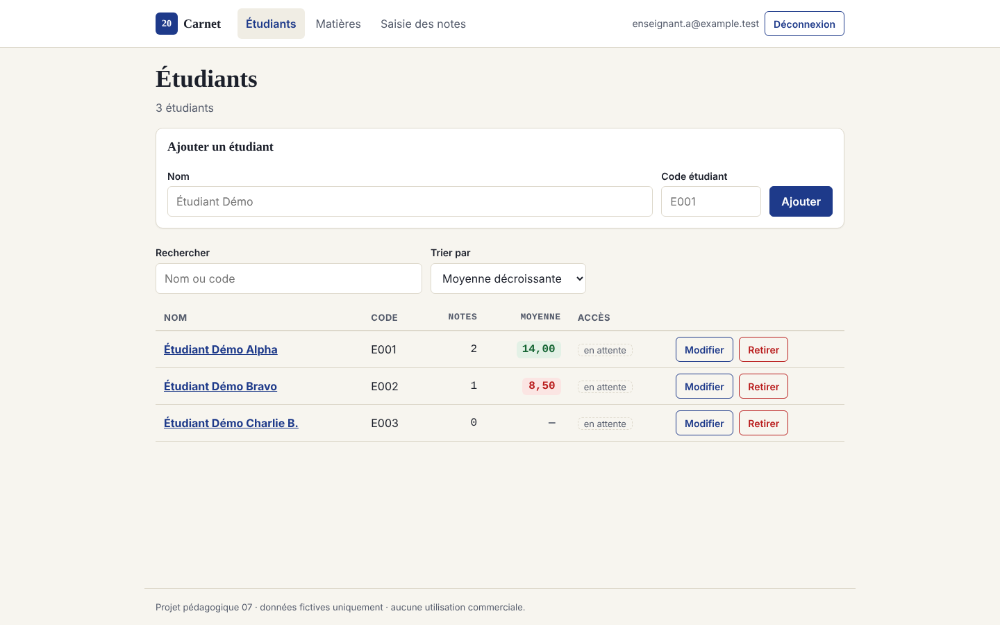
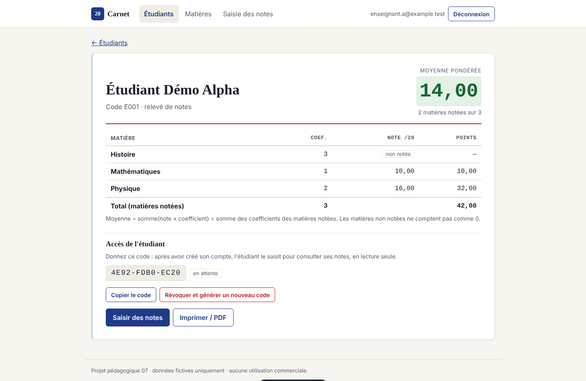
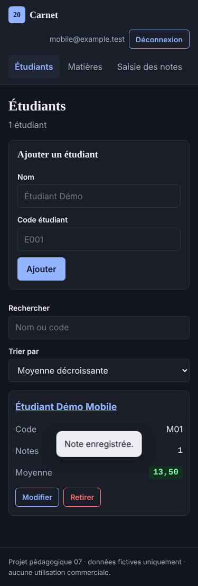
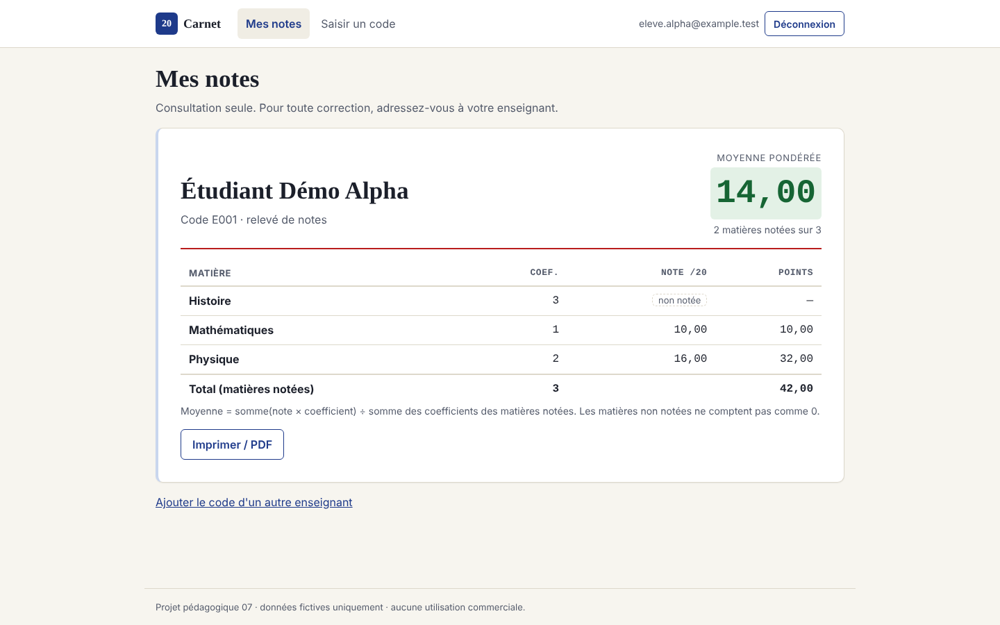

# Carnet — gestion des notes des étudiants

Projet web de gestion d'élève ou étudiants. Un enseignant ou un formateur (collège, lycée, supérieur, centre de formation) enregistre ses élèves ou étudiants, ses matières et leurs notes, puis consulte des moyennes pondérées fiables. Chaque enseignant n'accède qu'à ses propres données grâce à Supabase Auth et au Row Level Security (RLS).

> Démonstration pédagogique : données fictives uniquement, aucun usage commercial.

- **Démo en ligne** : [À REMPLACER après déploiement]
- **Stack** : HTML, CSS, JavaScript (modules ES, sans build) · Supabase (Postgres + Auth) · Vercel

## Fonctionnalités

| Exigence du cahier des charges | Où |
|---|---|
| Ajouter, modifier, retirer un étudiant | Écran **Étudiants** |
| Matières avec coefficient entier positif | Écran **Matières** |
| Saisir une note de 0 à 20 par étudiant et matière | Écran **Saisie des notes** |
| Relevé de notes et moyenne pondérée | **Fiche étudiant** (clic sur un nom) |
| Rechercher par nom, trier par moyenne | Écran **Étudiants** |
| Compte enseignant, accès restreint | **Connexion** + politiques RLS |
| Erreurs de validation, états de chargement | Tous les écrans |
| Bonus : relevé imprimable en PDF | Bouton « Imprimer / PDF » de la fiche |
| **v1.1 : espace élève / étudiant** (lecture seule) | Code d'accès sur la fiche → écran **Mes notes** |

### Règles de calcul

- Moyenne = somme(note × coefficient) ÷ somme des coefficients **des matières notées**.
- Une matière non notée est affichée « non notée » et n'est **pas** comptée comme 0.
- Un étudiant sans aucune note n'a pas de moyenne (« — ») et apparaît en dernier dans le tri.
- Moyennes arrondies à 2 décimales.

## Captures

| Liste des étudiants | Relevé de notes | Mobile (thème sombre) |
|---|---|---|
|  |  |  |

| Espace élève (v1.1) |
|---|
|  |

## Adapter le vocabulaire

Pour un public du secondaire, remplacez `étudiant` par `élève` dans [`app/js/labels.js`](app/js/labels.js) : tous les libellés de l'interface suivent. La base de données ne change pas.

## Installation

### 1. Créer la base Supabase (gratuit)

1. Créez un projet sur [supabase.com](https://supabase.com) (offre Free).
2. Ouvrez **SQL Editor**, collez le contenu de [`supabase/schema.sql`](supabase/schema.sql) et exécutez-le. Le script est idempotent : il peut être relancé sans risque.
3. Dans **Authentication > URL Configuration**, ajoutez l'URL du site (locale et Vercel) dans *Site URL* / *Redirect URLs*.
4. Dans **Project Settings > API**, copiez l'*URL du projet* et la clé **anon / publishable**.

### 2. Configurer l'application

Renseignez ces deux valeurs dans [`app/js/config.js`](app/js/config.js).

La clé `anon` est faite pour être publique : la sécurité repose sur les politiques RLS. **Ne mettez jamais la clé `service_role`** dans ce fichier ni dans le dépôt.

### 3. Lancer en local

```bash
npm run dev          # sert le dossier app/ sur http://localhost:3000
```

N'importe quel serveur statique convient (extension Live Server, `python -m http.server` dans `app/`…). Ouvrir `index.html` directement en `file://` ne fonctionne pas, car les modules ES l'interdisent.

### 4. Déployer sur Vercel

Importez le dépôt GitHub dans Vercel. Aucun build n'est nécessaire : `vercel.json` publie le dossier `app/` et ajoute des en-têtes de sécurité (CSP, anti-iframe…). Ajoutez ensuite l'URL Vercel dans les *Redirect URLs* de Supabase.

## Utilisation

1. **Créer un compte** (onglet « Créer un compte »), puis se connecter. Si la confirmation d'e-mail est activée dans Supabase, cliquez d'abord sur le lien reçu.
2. **Matières** : créer les matières et leur coefficient (entier de 1 à 100).
3. **Étudiants** : ajouter les étudiants (nom + code unique).
4. **Saisie des notes** : choisir une matière, saisir la note de chaque étudiant (virgule ou point acceptés), puis « Enregistrer ». Ressaisir une note la remplace ; « Effacer » la retire.
5. Cliquer sur un étudiant pour voir son **relevé** et sa moyenne, et l'imprimer.
6. **Donner l'accès à l'élève** : sur la fiche, copier le **code d'accès** et le transmettre. L'élève crée un compte en choisissant « Élève ou étudiant », saisit le code et consulte ses notes (lecture seule). « Révoquer » coupe l'accès et génère un nouveau code.

## Données

```
students (id, owner_id → auth.users, name, student_code,   unique (owner_id, student_code)
          user_id → auth.users (compte élève), access_code)   access_code unique
subjects (id, owner_id → auth.users, name, coefficient)    coefficient entier 1..100, unique (owner_id, name)
grades   (id, student_id → students, subject_id → subjects, value)
         value 0..20 (2 décimales), unique (student_id, subject_id), suppression en cascade
```

**Sécurité (RLS)** : sur `students` et `subjects`, un enseignant n'accède qu'aux lignes dont `owner_id` est son identifiant. Sur `grades`, une note n'est visible ou modifiable que si l'étudiant **et** la matière lui appartiennent ; il est donc impossible de noter l'étudiant d'un autre enseignant. `owner_id` est rempli automatiquement et ne peut pas être modifié. Le rôle anonyme n'a aucun droit.

**Espace élève (v1.1)** : un compte rattaché à une fiche peut **lire** cette fiche, ses notes et les matières de son enseignant, et rien d'autre ; il ne peut rien écrire. `user_id` et `access_code` ne s'écrivent que par les fonctions `claim_student(code)` (rattachement) et `reset_student_access(fiche)` (révocation, réservée au propriétaire). Le choix « enseignant / élève » à l'inscription ne sert qu'à l'affichage : la sécurité est entièrement dans la base.

## Tests

| Commande | Ce qui est vérifié | Résultat |
|---|---|---|
| `npm test` | Calcul de la moyenne (recette 10 coef 1 + 16 coef 2 = 14), validation des notes, coefficients et codes d'accès, recherche, tri, messages d'erreur | 11/11 PASS |
| `npm run test:db` | Sur un Postgres 16 local avec émulation de `auth.uid()` : contraintes, unicité, isolation entre deux enseignants A et B, accès anonyme refusé, cascade ; espace élève (rattachement, lecture seule, code unique, révocation) | 24/24 PASS |
| `npm run test:ui` | Parcours complet dans Chromium (faux Supabase en mémoire) : connexion, CRUD, refus de 21 et −1, relevé = 14,00, tri, isolation, espace élève, révocation, mobile 375 px en thème sombre sans débordement | 20/20 PASS |

`test:db` nécessite `psql` et une base de test vide (variables `PGHOST`, `PGDATABASE`…). **Ne pas l'exécuter sur la base Supabase** : le fichier `tests/db/supabase-shim.sql` crée des rôles et un schéma `auth` qui existent déjà sur Supabase. `test:ui` nécessite `npm install` puis `npx playwright install chromium`.

### Recette manuelle à faire après déploiement

- [ ] Notes 10 (coef. 1) et 16 (coef. 2) donnent une moyenne de 14,00.
- [ ] Les notes −1 et 21 sont refusées.
- [ ] Avec deux comptes A et B, B ne voit ni ne modifie les données de A.
- [ ] Le site s'ouvre en HTTPS sur un autre appareil (téléphone).

## Limites

- Le tri et la recherche se font dans le navigateur : adapté à quelques centaines d'étudiants, pas à des milliers.
- Pas de gestion des classes ou groupes (bonus non réalisé).
- Le projet Supabase gratuit peut être mis en pause après une période d'inactivité ; il se réactive depuis le tableau de bord.
- `supabase-js` est chargé depuis le CDN jsDelivr (version 2.45.4 épinglée) : l'application nécessite une connexion Internet.

## Structure

```
app/                 site publié (index.html, css/, js/)
  js/calc.js         règles métier pures (moyenne, validation, tri)
  js/api.js          accès Supabase
  js/app.js          écrans et navigation
supabase/schema.sql  tables, contraintes, RLS
tests/               tests unitaires, base et interface
docs/                captures et prompt d'exécution
```

## Documentation

- [Cahier des charges](docs/cahier-des-charges.md)
- [Rapport de développement](docs/rapport-developpement.md)
- [Rapport de déploiement](docs/rapport-deploiement.md) · [procédure pas à pas](docs/deploiement.md)
- [Prompt d'exécution](docs/prompt-execution.md) · [v1.1 espace élève](docs/prompt-execution-v1.1.md)
